# Банк

Тема № 18: **Банк**. База данных хранит клиентов банка, их счета, совместные счета, карты, операции по счетам, кредиты; она нужна сотрудникам банка для учета денег и контроля(баланс дебетового счета не должен уходить в минус).

| | |
| --- | --- |
| Главная таблица | `operations` |
| Связь N:M | `clients` и `accounts` через `account_holders` |
| Бизнес-правило | Баланс дебетового счёта не уходит в минус |
| СУБД | PostgreSQL 17 в Docker |

## Задания курса

Правила курса, установка и порядок сдачи: [docs/README.md](docs/README.md).

| Лаба | Задание |
| --- | --- |
| 1. Модель данных и схема | [docs/lab-1.md](docs/lab-1.md) |
| 2. Запросы | [docs/lab-2.md](docs/lab-2.md) |
| 3. Логика в базе | [docs/lab-3.md](docs/lab-3.md) |
| 4. Транзакции и доступ | [docs/lab-4.md](docs/lab-4.md) |
| 5. Производительность | [docs/lab-5.md](docs/lab-5.md) |
| Витрина к защите | [docs/showcase.md](docs/showcase.md) |

## Как запустить

```bash
cp .env.example .env          # пароли и порт
docker compose up -d          # при первом запуске выполняются скрипты из db/
dbcheck run demo/lab1.sql     # сценарий лабы 1
```

Работа с базой: `docker compose exec db psql -U postgres -d app`. Сценарии выполняются в `psql` командой `\i /demo/lab1.sql`.

После изменения скриптов в `db/` базу нужно пересоздать: `docker compose down -v && docker compose up -d`.

## ER-диаграмма

```mermaid
erDiagram
    clients ||--o{ account_holders : "владеет"
    accounts ||--o{ account_holders : "принадлежит"
    accounts ||--o{ cards : "к счету выпущена"
    clients ||--o{ cards : "выпущена на клиента"
    accounts ||--o{ operations : "проводятся по"
    cards ||--o{ operations : "оплата картой"
    clients ||--o{ credits : "берет"
    accounts ||--o{ credits : "обслуживается через"

    clients {
        int id PK
        text last_name
        text first_name
        text middle_name
        text passport UK
        text phone UK
        text email UK
        date birth_date
        timestamptz created_at
    }
    accounts {
        int id PK
        text number UK
        account_kind kind
        account_status status
        numeric balance
        char currency
        timestamptz opened_at
    }
    account_holders {
      int client_id PK, FK
      int account_id PK, FK
      boolean is_primary
      timestamptz added_at
    }
    cards {
      int id PK
      int account_id FK
      int client_id FK
      text number UK
      card_status status
      date expires_at
      date issued_at
    }
    operations {
      int id PK
      int account_id FK
      int card_id FK
      operation_kind kind
      numeric amount
      text description
      timestamptz created_at
    }
    credits {
      int id PK
      int client_id FK
      int account_id FK
      numeric principal
      numeric rate_percent
      int term_months
      credit_status status
      timestamptz issued_at
    }
```



## Ограничения

| Ограничение | Таблица и колонки | Зачем |
| --- | --- | --- |
| `UNIQUE` | `clients (passport)`, `clients (phone)`, `clients (email)` | Контакты человека не повторяются, один человек не заводится в банке дважды |
| `UNIQUE` | `accounts (number)`, `cards (number)` | Номер счета и номер карты должны однозначно определять объект |
| `CHECK` | `accounts`: `kind <> 'debit' OR balance >= 0` | Бизнес-правило: баланс дебетового счёта не уходит в минус |
| `CHECK` | `accounts (number)`, `cards (number)` | 20 цифр у счета, 16 у карты, первая цифра не 0 |
| `CHECK` | `operations (amount)` | Сумма операции всегда положительная, вид операции определяет `kind` (пополнение, снятие, ...) |
| `CHECK` | `credits (principal, rate_percent, term_months)` | Сумма и срок кредита > 0, ставка от 0 до 100 % |
| `CHECK` | `cards`: `expires_at > issued_at` | Дата выпуска карты раньше даты окончания её действия |
| `CHECK` | `clients (birth_date)` | Дата рождения > 1900 года, защита от опечаток в дате рождения |
| `NOT NULL` | Все поля, кроме `clients.middle_name`, `clients.email`, `operations.card_id` и `operations.description` | Обязательные данные не могут быть пустыми |

## Что сделано по лабам

| Лаба | Что сделано | Сценарий |
| --- | --- | --- |
| 1 | 6 таблиц (`01_schema.sql`), тестовые данные (`02_seed.sql`), 5000 сгенерированных операций (`03_generate.sql`) | `demo/lab1.sql` |
| 2 | 16 запросов (``) | `demo/lab2.sql` |
| 3 | ... | `demo/lab3.sql` |
| 4 | ... | `demo/lab4.sql`, `demo/race.sql`, `demo/race_fixed.sql` |
| 5 | ... | `demo/lab5.sql` |

## Нормализация (Лабораторная 1)

Исходная таблица, в которой всё в одном месте:

| операция | сумма | клиент ФИО | паспорт | телефон | номер счёта | тип счёта | баланс | номер карты | кредит |
| --- | --- | --- | --- | --- | --- | --- | --- | --- | --- |
| 1 | 3200.50 | Иванов И. И. | 4510 123456 | +79001110001 | 4081781... | debit | 125000.50 | 5469... | 100000 |
| 2 | 15000 | Иванов И. И. | 4510 123456 | +79001110001 | 4081781... | debit | 125000.50 | 5469... | 100000 |

Что здесь не так:

- **Повторы данных.** Фамилия, имя, паспорт и телефон клиента записаны в каждой его операции. При смене телефона его пришлось бы менять во всех строках, и где-нибудь остался бы старый. Баланс счёта тоже повторяется в каждой операции по нему.
- **1НФ.** У счёта может быть несколько владельцев, у клиента несколько карт. Такие списки в одной ячейке («Иванов, Петрова») нарушают 1НФ, поэтому владельцы вынесены в отдельную таблицу.
- **2НФ.** В таблице `account_holders` ключ составной `(client_id, account_id)`. В ней нет данных, которые зависели бы только от клиента или только от счёта: фамилия, имя и отчество лежат в `clients`, баланс в `accounts`. Остались только свойства самой связи (`is_primary`, `added_at`).
- **3НФ.** Неключевые колонки не зависят друг от друга: тип и баланс счёта зависят только от счёта, ставка и срок только от кредита.

Как разделено:

| Таблица | Что хранит |
| --- | --- |
| `clients` | Данные человека |
| `accounts` | Данные счёта |
| `account_holders` | Кто чем владеет (N:M) |
| `cards` | Карты: ссылка на счёт и клиента |
| `operations` | Только суммы и вид операции, остальное по ссылке на счёт |
| `credits` | Параметры кредита, ссылки на клиента и счёт |

## Типы данных (Лабораторная 1)

| Что | Тип | Почему |
| --- | --- | --- |
| Деньги (`balance`, `amount`, `principal`) | `numeric(14, 2)` | `float` хранит числа приближённо, для денег это недопустимо |
| Процентная ставка | `numeric(5, 2)` | Точное значение, например 14.50 |
| Моменты времени (`created_at`, `opened_at`) | `timestamptz` | Учитывает часовой пояс |
| Даты без времени (`birth_date`, `expires_at`, `issued_at`) | `date` | Время суток не нужно |
| Вид и статус счёта, карты, операции, кредита | `enum` | База данных не примет значение вне списка |
| Номера счёта и карты | `text` + `CHECK` на формат | Хранятся как строки + `CHECK` проверяет формат: количество цифр и то, что первая цифра не 0 |

## Что происходит при удалении (Лабораторная 1)

У каждого внешнего ключа явно указан `ON DELETE`.

| Связь | ON DELETE | Причина |
| --- | --- | --- |
| `account_holders.client_id` → `clients` | `RESTRICT` | Клиента, у которого есть счета, удалять нельзя: сначала нужно закрыть счета |
| `account_holders.account_id` → `accounts` | `CASCADE` | Если счёт удалён, связи «клиент-счёт» теряют смысл |
| `cards.account_id` → `accounts` | `CASCADE` | Карта без счёта не нужна, удаляется вместе со счётом |
| `cards.client_id` → `clients` | `RESTRICT` | Клиента с выпущенными картами удалять нельзя |
| `operations.account_id` → `accounts` | `RESTRICT` | История операций это финансовый документ, счёт с операциями удалять нельзя |
| `operations.card_id` → `cards` | `SET NULL` | Если карту удалили, операция остаётся в истории, просто без карты |
| `credits.client_id` → `clients` | `RESTRICT` | Нельзя удалить клиента с кредитом |
| `credits.account_id` → `accounts` | `RESTRICT` | Нельзя удалить счёт, по которому идёт кредит |

## Запросы (Лабораторная 2)

Сценарий `demo/lab2.sql`. Запросы, которые меняют данные, обёрнуты в `BEGIN; ... ROLLBACK;`, поэтому база после запуска не портится.

| № | Вопрос | Что использовано |
| --- | --- | --- |
| 1 | Какие активные счета у каждого клиента | `JOIN` 3-х таблиц (`clients` + `account_holders` + `accounts`) |
| 2 | Какие счета совместные (больше одного владельца) | `GROUP BY` + `HAVING` + `count` |
| 3 | Сколько операций каждого вида, их сумма и средняя сумма | `GROUP BY`, `count`, `sum`, `avg` |
| 4 | Какие счета без выпущенной карты? | `LEFT JOIN` + `IS NULL` |
| 5 | Какие клиенты ни разу не брали кредит? | подзапрос с `NOT EXISTS` |
| 6 | На каких активных дебетовых счетах баланс выше среднего по дебетовым счетам? | скалярный подзапрос |
| 7 | Кто просрочил кредит | `JOIN` 3-х таблиц (`credits` + `clients` + `accounts`) |
| 8 | Сколько кредитов в каждом статусе, на какую сумму выдано и какая средняя ставка? | `GROUP BY` + `count` + `sum` + `avg` |
| 9 | Последние 5 операций по всем счетам клиента Иванова (id = 1) | подзапрос с `IN` |
| 10 | Клиент Иванов (id = 1) открывает сберегательный счёт: число его счетов до и после | `INSERT` до и после |
| 11 | Банк начисляет 5% на активные сберегательные счета: суммарный остаток до и после | `UPDATE` до и после |
| 12 | Удаление просроченных карт: сколько карт в базе до и после | `DELETE` до и после |
| 13 | Топ-3 счёта по сумме операций внутри каждого типа счёта | `WITH` + `RANK() OVER (PARTITION BY ...)` |
| 14 | Как менялся баланс счёта 1 по операциям: накопительная сумма | `SUM() OVER (ORDER BY ...)` |
| 15 | Оборот по месяцам: сумма операций, прошлый месяц и изменение в процентах | `date_trunc`, `LAG` |
| 16 | Платежи по счёту 1 за последние 30 дней по дням, включая дни без платежей | `WITH RECURSIVE` |


<!--
  Разделы, которые добавляются по ходу курса:
  лаба 1 ★: «Нормализация», «Типы данных»; ★★: «Что происходит при удалении»;
  лаба 4: «Гонка»;
  лаба 5: «Производительность» (таблица до / после, когда индекс не помогает, размеры).
-->
